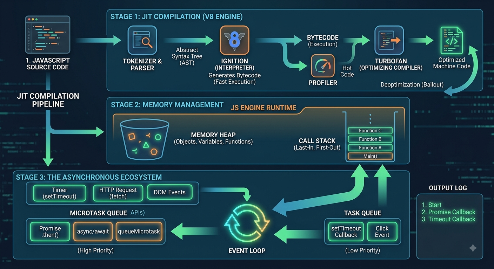

# JavaScript

* variables
* Data Dypes
* Operators
  * Arthimetic
  * Assignment
  * Comparision
  * Bit wise
  * Logical
  * Increment/Decrement
* Conditional Statements
  * Switch case
  * if statements
* Loops
* OOPs
* this keyword
* Proxy object
* == vs === vs Object.is()

## JavaScript
- single threaded
- synchronous langauge
- compiled and interpreted language
- Used hybrid model

### == vs === vs Object.is()

| Feature / Case           | `==` (loose equality) | `===` (strict equality) | `Object.is()`      |
| ------------------------ | --------------------- | ----------------------- | ------------------ |
| Type coercion            | ✅ Yes                 | ❌ No                    | ❌ No               |
| General comparison       | After coercion        | Direct comparison       | Direct comparison  |
| `5` vs `'5'`             | ✅ true                | ❌ false                 | ❌ false            |
| `true` vs `1`            | ✅ true                | ❌ false                 | ❌ false            |
| `null` vs `undefined`    | ✅ true                | ❌ false                 | ❌ false            |
| `NaN` vs `NaN`           | ❌ false               | ❌ false                 | ✅ true             |
| `+0` vs `-0`             | ✅ true                | ✅ true                  | ❌ false            |
| Objects (same reference) | ✅ true                | ✅ true                  | ✅ true             |
| Objects (different refs) | ❌ false               | ❌ false                 | ❌ false            |
| Practical usage          | Rare (can be tricky)  | Most common             | Niche (edge cases) |

> 📝 In Short
> * == → does type conversion → can lead to surprising results
> * === → safest default → no coercion
> * Object.is() → like ===, but:
>   * treats NaN as equal
>   * distinguishes +0 and -0

