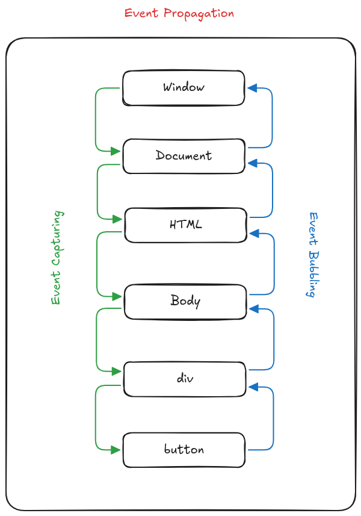
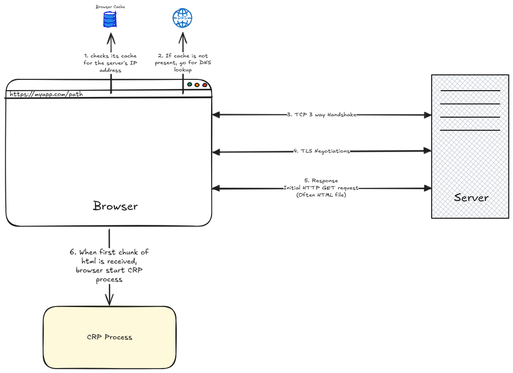
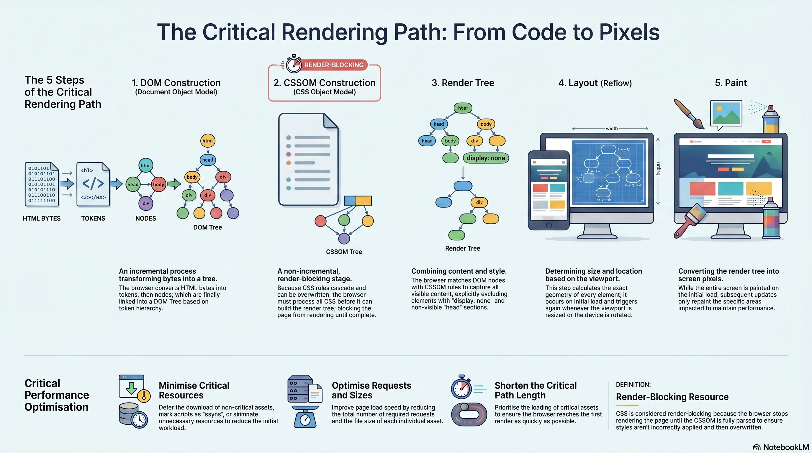

# Object Model

* DOM
* Events
* Event bubbling
* Event Capturing
* Event propagation
* Event Delegation
* Event preventDefault
* Event handler
* Event Listener
* CRP (Critical Rendering Path)

## Event Propagation -- Captuting -- Bubbling

## How Browser works

> Refer this link
> https://developer.mozilla.org/en-US/docs/Web/Performance/Guides/How_browsers_work

### CRP (Critical Rendering Path)

> Refer this link
> https://developer.mozilla.org/en-US/docs/Web/Performance/Guides/Critical_rendering_path

### DOM Construction is incremental

"Incremental" construction means that the browser **does not wait** for the entire HTML document to be downloaded or parsed before it begins building the DOM and displaying content to the user.

Instead, the browser builds the DOM tree bit-by-bit as the data arrives from the network.

#### How Incremental Construction Works

1.  **Continuous Processing:** As soon as the browser receives the first chunk of HTML bytes (even if it's only the `<head>` or the start of the `<body>`), it starts parsing those tokens and creating DOM nodes immediately.
2.  **Early Rendering:** Because the construction is incremental, the browser can start calculating the layout and "painting" pixels to the screen before the entire page has finished loading. This is why you often see a page "pop" into view—text or images may appear while the browser is still downloading the rest of the HTML, CSS, or JavaScript at the bottom of the page.
3.  **The "Streaming" Effect:** Think of it like a live video stream. You don't wait for the whole movie to download to start watching the first few seconds; the browser "streams" the HTML content, parses it, and updates the screen in real-time.

#### Why this matters (Performance)

* **Improved User Experience:** It makes the website feel much faster. If a browser had to wait for the complete file to arrive, you would see a blank white screen for the entire duration of the download.
* **Progressive Loading:** Web developers leverage this by placing critical content (like headers, text, and primary structure) at the top of the HTML file. Because the browser builds the DOM incrementally from top to bottom, putting essential content first ensures the user sees something meaningful as quickly as possible.
* **The "Blocking" Exception:** While the DOM construction is incremental, certain things can pause it. For example, when the parser encounters a `<script>` tag, it usually stops DOM construction until the script has been downloaded and executed. This is why developers often place scripts at the bottom of the page or use attributes like `defer` or `async` to keep the DOM construction flowing.

In short, "incremental" means the browser works in a **continuous loop**: *Receive Data $\rightarrow$ Parse Tokens $\rightarrow$ Add Node to DOM $\rightarrow$ Update Display*, rather than waiting for the entire transmission to finish.
