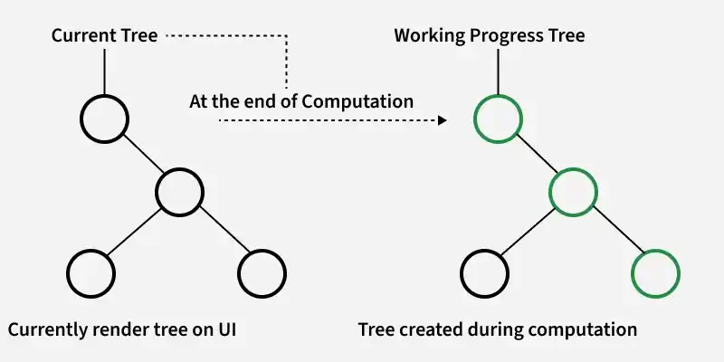

# Level-1 Heading

## Level-2 Heading

### Level-3 Heading

#### Level-4 Heading

##### Level-5 Heading

###### Level-6 Heading


`code`

**bold**

*Italic*

`underline`

Normal

Link [Markdown Guide](https://www.markdownguide.org)

```Python
is_python = True
```

```Javascript
let isJavascript = true;
```


| Column1 | Column2 |
|---------|------|
| Value1 | Value2 |
| Vaue3 | Value4 |

* Point-1
* Point-2
___

1) Point-1
2) Point-2

> Block
>
> Block
>> Nested Block -1
>>> Nested Block - 2

<div style="height:10px"></div>




<div align="center"></div>


> **☠️ Pitfall**  
> Title
>> Description


> **💡 Insight**  
> Title
>> Description

> 📝 In Short
> Title
>> Description


> 🔑 Core / Most Common
> * Tip
> * Note
> * Important
> * Warning
> * Caution
> * Info

> ⚡ Guidance & Advice
> * Best Practice
> * Recommendation
> * Advice
> * Pro Tip
> * Quick Tip
> * Hint
> * Suggestion

> ⚠️ Risks & Mistakes
> * Pitfall
> * Common Mistake
> * Watch Out
> * Danger
> * Don’t Do This
> * Gotcha

> 📘 Explanations & Context
> * Explanation
> * Insight
> * Background
> * Context
> * Why It Matters
> * Key Idea

> 🛠️ Practical / Action-Oriented
> * Steps
> * How-To
> * Action
> * Checklist
> * Do This
> * Try This

> 📊 Extra Value
> * Example
> * Case Study
> * Use Case
> * Scenario
> * Illustration

> 🧠 Learning & Memory
> * Key Takeaway
> * Summary
> * Recap
> * Remember
> * In Short

> 🔍 Advanced / Technical
> * Deep Dive
> * Advanced Tip
> * Technical Note
> * Behind the Scenes

> 🎯 Emphasis / Priority
> * Must Know
> * Critical
> * Essential
> * High Priority

> 💡 Fun / Modern Variations (less formal)
> * Hack
> * Life Hack
> * Insider Tip
> * Did You Know?
> * Fun Fact