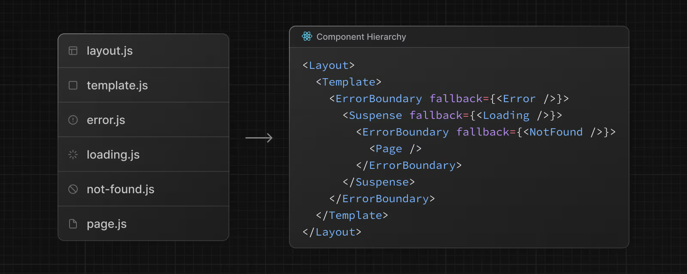
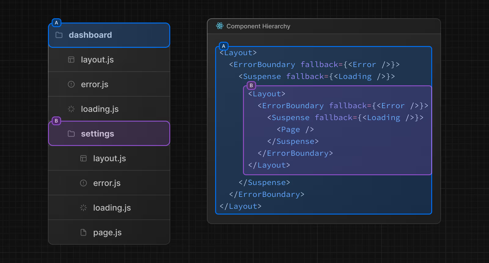
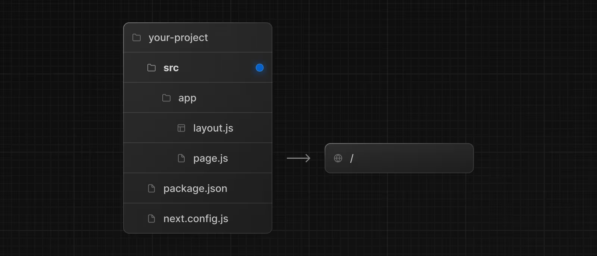

### Routing Files

Add `page` to expose a route, `layout` for shared UI such as header, nav, or footer, `loading` for skeletons, `error` for error boundaries, and `route` for APIs.

|                                                                               |                     |                              |
| ----------------------------------------------------------------------------- | ------------------- | ---------------------------- |
| `layout`                   | `.js` `.jsx` `.tsx` | Layout                       |
| `page`                       | `.js` `.jsx` `.tsx` | Page                         |
| `loading`                 | `.js` `.jsx` `.tsx` | Loading UI                   |
| `not-found`             | `.js` `.jsx` `.tsx` | Not found UI                 |
| `error`                     | `.js` `.jsx` `.tsx` | Error UI                     |
| `global-error` | `.js` `.jsx` `.tsx` | Global error UI              |
| `route`                     | `.js` `.ts`         | API endpoint                 |
| `template`               | `.js` `.jsx` `.tsx` | Re-rendered layout           |
| `default`                 | `.js` `.jsx` `.tsx` | Parallel route fallback page |

### Nested routes

Folders define URL segments. Nesting folders nests segments. Layouts at any level wrap their child segments. A route becomes public when a `page` or `route` file exists.

| Path                        | URL pattern     | Notes                         |
| --------------------------- | --------------- | ----------------------------- |
| `app/layout.tsx`            | —               | Root layout wraps all routes  |
| `app/blog/layout.tsx`       | —               | Wraps `/blog` and descendants |
| `app/page.tsx`              | `/`             | Public route                  |
| `app/blog/page.tsx`         | `/blog`         | Public route                  |
| `app/blog/authors/page.tsx` | `/blog/authors` | Public route                  |

### Dynamic routes

Parameterize segments with square brackets. Use `[segment]` for a single param, `[...segment]` for catch‑all, and `[[...segment]]` for optional catch‑all. Access values via the `params` prop.

| Path                            | URL pattern                                                          |
| ------------------------------- | -------------------------------------------------------------------- |
| `app/blog/[slug]/page.tsx`      | `/blog/my-first-post`                                                |
| `app/shop/[...slug]/page.tsx`   | `/shop/clothing`, `/shop/clothing/shirts`                            |
| `app/docs/[[...slug]]/page.tsx` | `/docs`, `/docs/layouts-and-pages`, `/docs/api-reference/use-router` |

### Route groups and private folders

Organize code without changing URLs with route groups `(group)`, and colocate non-routable files with private folders `_folder`.

| Path                            | URL pattern | Notes                                     |
| ------------------------------- | ----------- | ----------------------------------------- |
| `app/(marketing)/page.tsx`      | `/`         | Group omitted from URL                    |
| `app/(shop)/cart/page.tsx`      | `/cart`     | Share layouts within `(shop)`             |
| `app/blog/_components/Post.tsx` | —           | Not routable; safe place for UI utilities |
| `app/blog/_lib/data.ts`         | —           | Not routable; safe place for utils        |

### Parallel and Intercepted Routes

These features fit specific UI patterns, such as slot-based layouts or modal routing.

Use `@slot` for named slots rendered by a parent layout. Use intercept patterns to render another route inside the current layout without changing the URL, for example, to show a details view as a modal over a list.

| Pattern (docs)                                                                              | Meaning              | Typical use case                         |
| ------------------------------------------------------------------------------------------- | -------------------- | ---------------------------------------- |
| `@folder`                 | Named slot           | Sidebar + main content                   |
| `(.)folder`      | Intercept same level | Preview sibling route in a modal         |
| `(..)folder`     | Intercept parent     | Open a child of the parent as an overlay |
| `(..)(..)folder` | Intercept two levels | Deeply nested overlay                    |
| `(...)folder`    | Intercept from root  | Show arbitrary route in current view     |


### Component hierarchy






### Colocation

In the `app` directory, nested folders define route structure. Each folder represents a route segment that is mapped to a corresponding segment in a URL path.

However, even though route structure is defined through folders, a route is not publicly accessible until a `page.js` or `route.js` file is added to a route segment.

And, even when a route is made publicly accessible, only the content returned by `page.js` or `route.js` is sent to the client.

This means that project files can be safely colocated inside route segments in the app directory without accidentally being routable.


### `src` folder

Next.js supports storing application code (including app) inside an optional `src` folder. This separates application code from project configuration files which mostly live in the root of a project.




### Creating a page

* It is UI that is rendered on a specific route
* Define a page by default exporting a react component from `page.tsx` file

```typescript
// app/page.tsx

export default function Page() {
  return <h1>Hello Next.js!</h1>
}
```

### Creating a layout

* Shared UI b/w multiple pages
* Preserve state, remain interactive, do not re-render
* Define a layout by default exporting a react component from `layout.tsx` file
* Component should accept children
* Root level layout is required and must contain `html` and `body` tags.

```typescript
// app/layout.tsx

export default function DashboardLayout({
  children,
}: {
  children: React.ReactNode
}) {
  return (
    <html lang="en">
      <body>
        {/* Layout UI */}
        {/* Place children where you want to render a page or nested layout */}
        <main>{children}</main>
      </body>
    </html>
  )
}
```

### Nesting layouts

* Layouts in the folder hierarchy are also nested
* Nest layouts by adding layout inside specific route segments (folders)
* In the following examples, the root layout (`app/layout.tsx`) would wrap the blog layout (`app/blog/layout.tsx`)

```typescript
// app/blog/layout.tsx

export default function BlogLayout({
  children,
}: {
  children: React.ReactNode
}) {
  return <section>{children}</section>
}
```

### Route props helpers

* NextJs exposes utility types. As they are global helpers, no imports are required
* **PageProps:** Props for page components, including params and searchParams.
* **LayoutProps:** Props for layout components, including children and any named slots (e.g. folders like @analytics).

```typescript
// app/blog/[slug]/page.tsx

export default async function Page(props: PageProps<'/blog/[slug]'>) {
  const { slug } = await props.params
  return <h1>Blog post: {slug}</h1>
}
```

```typescript
// app/dashboard/layout.tsx

export default function Layout(props: LayoutProps<'/dashboard'>) {
  return (
    <section>
      {props.children}
      {/* If you have app/dashboard/@analytics, it appears as a typed slot: */}
      {/* {props.analytics} */}
    </section>
  )
}
```

### Linking b/w pages

* Use `<Link>` component to navigate b/w routes
* It extends HTML `<a>` tag
* use `useRouter` hook for more advanced navigation
* Routes are rendered on the server by default. So Client has to wait for a server response before a new route can be shown

**Server Rendering**

* Layouts and pages are React Server Components by default
* On initial and subsequent navigations, Server component payload is generated on the before being sent to the client
* 2 types of server rendering based on when it happens
  * **Pre-rendering** happens at build time
  * **Dynamic Rendering** happens at request time

**Prefetching**

* Prefetching is the process of loading a route in the background before the user navigates to it
* It makes app feel instant, because by the time a user clicks on a link, the data to render the next route is already available client side
* It happens when `<Link>` component enters the user's viewport
* **For static route**, the full route is prefetched
* **For dynamic route**, prefetching is skipped, or the route is partially prefetched if `loading.tsx` is present.


**Streaming**

* Streaming allows the server to send parts of a dynamic route to the client as soon as they're ready, rather than waiting for the entire route to be rendered
* For dynamic routes, t means they can be partially prefetched. That is, shared layouts and loading skeletons can be requested ahead of time
* NextJs will automatically wrap the `page.tsx` contents in a `<Suspense>` boundary


**Client-side transitions**

* Traditionally, navigation to a server-rendered page triggers a full page load. This clears state, resets scroll position, and blocks interactivity
* Next.js avoids this with client-side transitions using the `<Link>` component
* Instead of reloading the page, it updates the content dynamically by:
  * Keeping any shared layouts and UI.
  * Replacing the current page with the prefetched loading state or a new page if available.
* Client-side transitions are what makes a server-rendered apps feel like client-rendered apps


### Slow networks

On slow or unstable networks, prefetching may not finish before the user clicks a link. This can affect both static and dynamic routes. In these cases, the loading.js fallback may not appear immediately because it hasn't been prefetched yet.

To improve perceived performance, you can use the `useLinkStatus` hook to show immediate feedback while the transition is in progress.

### Client components

Use Client components when you need:
* State and event handlers. E.g. onClick, onChange
* Lifecycle logic. E.g. useEffect
* Browser-only APIs. E.g. localStorage, window, Navigator.geolocation, etc
* Custom hooks

Create client component by using `use client` directive

```typescript
// app/ui/counter.tsx

'use client'
 
import { useState } from 'react'
 
export default function Counter() {
  const [count, setCount] = useState(0)
 
  return (
    <div>
      <p>{count} likes</p>
      <button onClick={() => setCount(count + 1)}>Click me</button>
    </div>
  )
}
```

* Once a file is marked with "use client", all of its imports and the components it directly renders are included in the client bundle
* This means you don’t need to add the directive to every component that is intended for the client
* This behavior applies to components that are part of the Client Component’s module graph, which includes the modules it imports and the components it renders directly
* It doesn't apply to **Server components** passed as **children** or other props
* Those components are not imported into the Client Component’s module graph
* They are rendered on the server and passed to the Client Component as rendered output

### Server components

Use Server Components when you need:
* Fetch data from databases or APIs close to the source
* Use API keys, tokens, and other secrets without exposing them to the client
* Reduce the amount of JavaScript sent to the browser
* Improve the First Contentful Paint (FCP), and stream content progressively to the client

### Work together

* Server Components are rendered into a special data format called the React Server Component Payload (RSC Payload).
* Client Components and the RSC Payload are used to prerender HTML.

**What is the React Server Component Payload (RSC)?**

The RSC Payload is a compact binary representation of the rendered React Server Components tree. It's used by React on the client to update the browser's DOM. The RSC Payload contains:

* The rendered result of Server Components
* Placeholders for where Client Components should be rendered and references to their JavaScript files
* Any props passed from a Server Component to a Client Component

### On the client (first load)

1. HTML is used to immediately show a fast non-interactive preview of the route to the user.
2. RSC Payload is used to reconcile the Client and Server Component trees.
3. JavaScript is used to hydrate Client Components and make the application interactive.

**What is hydration?**

Hydration is React's process for attaching event handlers to the DOM, to make the static HTML interactive.

### Subsequent Navigations

On subsequent navigations:

* The RSC Payload is prefetched and cached for instant navigation.
* Client Components are rendered entirely on the client, without the server-rendered HTML.


### Reduce JS bundle size

To reduce the size of your client JavaScript bundles, add `'use client'` to specific interactive components instead of marking large parts of your UI as Client Components.

For example, the `<Layout>` component contains mostly static elements like a logo and navigation links, but includes an interactive search bar. `<Search />` is interactive and needs to be a Client Component, however, the rest of the layout can remain a Server Component.

```typescript
// app/layout.tsx

// Client Component
import Search from './search'
// Server Component
import Logo from './logo'
 
// Layout is a Server Component by default
export default function Layout({ children }: { children: React.ReactNode }) {
  return (
    <>
      <nav>
        <Logo />
        <Search />
      </nav>
      <main>{children}</main>
    </>
  )
}

____________________________________________

// app/ui/search.tsx

'use client'
 
export default function Search() {
  // ...
}
```


### Third-party packages

* **server-only**:
  * These functions/methods/variables should be used in server components
  * Throws build time error
* **client-only**:
  * These functions/methods/variables should be used in client components
  * Throws build time error

