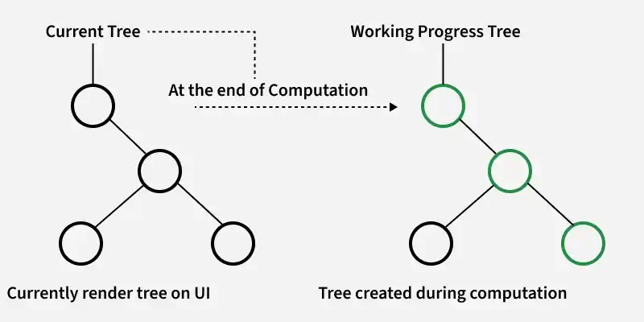
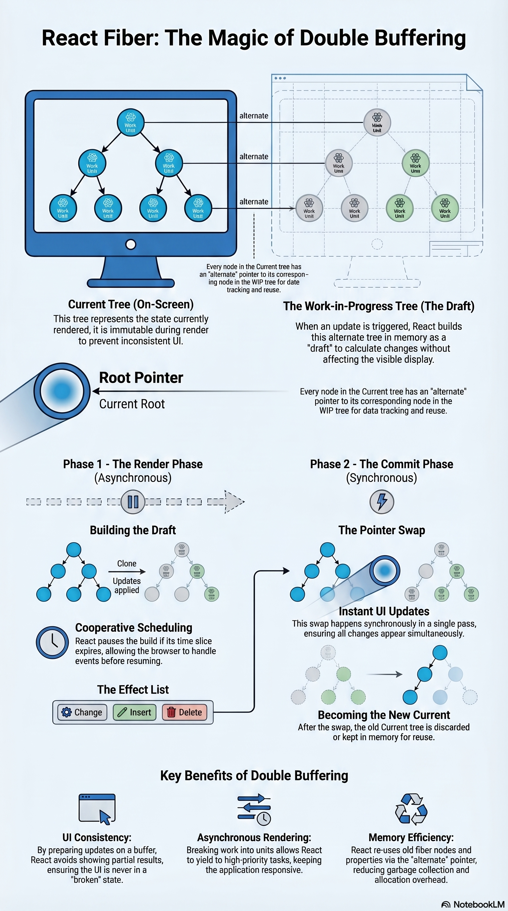

# React Fiber (Newer version)

| Sources |
|---------|
| https://blog.logrocket.com/deep-dive-react-fiber |
| https://youtu.be/0ympFIwQFJw?si=He4L3Ic8FWqHojvV |
| https://medium.com/@akashsdas_dev/react-fiber-reconciler-11986b384324 (yet to read) |
| https://angular.love/inside-fiber-in-depth-overview-of-the-new-reconciliation-algorithm-in-react (yet to read) |


- Core reconciliation engine
- Introduced in react 16
- Complete re-implementation of stack reconciliation algorithm
- Uses an asynchronous rendering model

Old reconciliation engine:
- Used before react 16
- Stack recociler
- Recursive Traversal
- Single priority
- Updates are synchronous
- Once started rendering, cannot be intercepted
- UI delay
- Drop UI frames
- Less responsive


Fiber primarily focused on:
- Rendering performance
- Make UI updates smoother
- Responsive UI updates
- Improve animations

Fiber does:
- Rendering work more efficiently
- Efficiently manage and prioritize update tasks
- Breaking the rendering into smaller, prioritized tasks
- Allows work to be paused, resumed, reused, or aborted when necessary


### Fiber Node

- A plain JavaScript object
- A unit of work
- Each element in the component tree corresponds to a fiber node
- While React elements are immutable descriptions of the UI that are recreated on every render, Fiber nodes are mutable data structures that are reused as often as possible to hold a component's state, props, and underlying DOM elements.


---

#### **1. Identification and Metadata Properties**
These properties define the "what" and "who" of the fiber node.

*   **`tag`**: A number (currently 0–24) that defines the **type of work** to be performed. It identifies the fiber's role, such as a `FunctionComponent`, `ClassComponent`, or `HostComponent` (a DOM node like `div`).
*   **`type`**: For composite components (classes or functions), this points to the **constructor or function** itself. For host components, it is a string representing the **HTML tag** (e.g., `'div'`, `'span'`).
*   **`key`**: This is the same unique identifier provided in the React element. It is used during reconciliation to help React determine which items in a list have changed, been added, or been removed.
*   **`stateNode`**: Holds a reference to the **actual instance** associated with the fiber, such as a class component instance or a physical DOM node. This allows React to access the local state associated with the fiber.

---

#### **2. Structural Relationship Properties**
Unlike traditional trees that use arrays for children, Fiber uses a **singly-linked list** structure. This allows the reconciler to traverse the tree without recursion, enabling it to pause and resume work.

*   **`child`**: Points only to the **first child** element returned by the component's `render()` method.
*   **`sibling`**: Points to the **immediate next sibling** node. If a component returns multiple elements (like a list), they are linked together via this property.
*   **`return`**: This is a logical return to the parent fiber node. It represents the **parent** and indicates where React should go after completing the current unit of work.

**Visual Representation of Relationships:**
```text
      [Parent Fiber]
            |
         (child)
            ↓
      [First Child] —(sibling)→ [Second Child] —(sibling)→ [Third Child]
            |                        |                       |
        (return)                 (return)                (return)
            └────────────────────────┴───────────────────────┘
```

---

#### **3. State and Props Management**
These properties track the data used to render the component and manage upcoming updates.

*   **`pendingProps`**: These are the **new props** that have been passed to the component from React elements and need to be applied.
*   **`memoizedProps`**: These are the props used during the **previous render** to create the current output. If `pendingProps` equals `memoizedProps`, React can often reuse the previous output and skip work.
*   **`memoizedState`**: The **internal state** of the fiber that was used to create the current output on the screen.
*   **`updateQueue`**: A queue that stores **state updates**, callbacks, and DOM updates that need to be processed for this specific fiber.

---

#### **4. Reconciliation and Side-Effect Properties**
These properties are used by the engine to track what changes need to be "flushed" to the screen.

*   **`alternate`**: This is the core of **double buffering**. At any time, a component instance has at most two fibers: the **current** fiber (on screen) and the **work-in-progress** fiber (the draft). The `alternate` property points to the counterpart in the other tree.
*   **`effectTag`**: A bitmask or flag that encodes the **side-effect** to be performed, such as `Placement` (insertion), `Update`, or `Deletion`.
*   **`nextEffect`**: Used to create a **linear list of effects**. Instead of re-traversing the whole tree during the commit phase, React follows these pointers to quickly iterate only over nodes that have work to do.

---

#### **5. Scheduling Properties**
*   **`expirationTime` / `childExpirationTime`**: Used by the **Scheduler** to determine the priority and deadline of the work associated with the fiber.
*   **`pendingWorkPriority`**: A number indicating the **priority level** of the task (e.g., Synchronous, Task, Animation, High, Low). A larger number generally indicates a lower priority.


### Fiber Tree
- A data structure used by React to hold information about components
- Manage the reconciliation process
- Fiber nodes are linked together to form a fiber tree
- Mirroring the structure of the component tree


### Miscellaneous
- Work Loop: Fiber introduces a work loop that processes units of work in a cooperative scheduling manner. This means React can pause and resume work, prioritizing more urgent updates to maintain a responsive user interface.
- Priority Levels: Fiber assigns priority levels to different types of updates. High-priority updates (like user interactions) are processed before lower-priority updates (like network responses).


### Architecture:

**Structural Architecture:** The Singly-Linked List
Unlike a traditional tree where a parent node maintains an array of all its children, the Fiber tree is composed of nodes connected via a singly-linked list. This structure is critical because it allows React to traverse the tree using a simple while loop rather than recursion, which is what enables the engine to pause and resume work.


### Double Buffering

- a concept borrowed from video game programming, where graphics are prepared in an invisible "back buffer" and then instantly swapped with the visible "front buffer" once complete.
- React implements this by maintaining two separate Fiber trees simultaneously

#### **1. The Two-Tree Architecture**
- **Current Tree:** It represents what is currently rendered on the screen.
- **WorkInProgress Tree:** It is where React prepares all upcoming changes.

<div align="center"></div>


#### **2. The "Alternate" Relationship**
Every Fiber node in the current tree has a property called **`alternate`**, which points to its counterpart in the workInProgress tree (and vice versa). This link is crucial because it allows React to **reuse existing Fiber nodes** rather than creating new ones from scratch for every update, significantly improving performance.

#### **3. The Swap (Commit Phase)**
The transition between these two trees occurs during the **commit phase**:
*   Once React finishes processing all units of work in the workInProgress tree, it marks the tree as a **"finished work"** ready to be shown.
*   React then performs a **pointer swap**: the root pointer that was pointing to the "current" tree is updated to point to the "workInProgress" tree.
*   The previous "current" tree then becomes the new "workInProgress" tree for the next round of updates.


#### **4. Key Benefits of Double Buffering**
*   **UI Consistency:** React ensures that the DOM is updated "in one go". The user never sees a partially updated UI because changes are only made visible after the entire tree is prepared.
*   **Interruptible Rendering:** Because work is done on a draft tree, React can **pause, abort, or prioritize** tasks in the render phase without the user noticing any "jank" or flickering in the live UI.
*   **Memory Efficiency:** By reusing nodes via the `alternate` property, React saves time on **memory allocation and garbage collection**. It can simply copy key values over from the old objects to the new ones during the next update cycle.





### How Fiber Works

Fiber operates through two primary phases:
- Render Phase
- Commit Phase

#### **1. The Render Phase (Asynchronous & Interruptible)**
This phase is responsible for identifying what changes need to be made by building a **work-in-progress (WIP) tree**. 

*   **Asynchronous Nature:** Unlike the old stack reconciler, the render phase is **interruptible**. React performs work in small chunks called "units of work". It monitors an internal timer; if the 16ms frame budget (for 60 FPS) is nearly exhausted, React pauses the work, yields control to the main thread for browser housekeeping or high-priority events, and resumes later.
*   **The Work Loop:** React traverses the fiber tree using a **parent-first, depth-first search**. This is handled by a `while` loop (not recursion) that calls two core functions:
    *   **`beginWork()`:** "Steps into" a component to determine what it renders based on new props/state.
    *   **`completeWork()`:** "Steps out" of a component after its children are processed, bubbling up changes.
*   **Effect List Generation:** As React traverses the WIP tree, it identifies nodes requiring DOM updates or lifecycle calls and tags them with an `effectTag`. These nodes are linked into a linear **Effect List** (often described as a "Christmas tree" of effectful nodes) for fast iteration during the next phase.
*   **Lifecycles:** Methods like `getDerivedStateFromProps`, `shouldComponentUpdate`, and `render` are executed during this phase. Because this phase can be restarted or aborted, these methods should not contain side-effects.

**The Traversal Diagram (Depth-First Search):**
React uses a `while` loop to traverse the tree. It follows a specific "wave" pattern:
```text
      beginWork(HostRoot)
               |
      beginWork(App)
               |
      beginWork(Header) -> completeWork(Header) (No children)
               |
      sibling: beginWork(Content)
               |
      beginWork(Item) -> completeWork(Item)
               |
      completeWork(Content)
               |
      completeWork(App)
               |
      completeWork(HostRoot)
```

#### **2. The Commit Phase (Synchronous & Uninterruptible)**
Once the render phase finishes and the WIP tree is marked as "finished work," React enters the commit phase to apply those changes to the screen.

*   **Synchronous Nature:** This phase is **uninterruptible** to prevent the user from seeing a partially updated or inconsistent UI. 
*   **Applying Effects:** React iterates over the **Effect List** created in the render phase. It uses `commitWork()` to perform the actual DOM mutations (insertions, updates, deletions).
*   **Double Buffering (The Swap):** After applying DOM changes, React performs a **pointer swap**. The root pointer that previously pointed to the "current" tree is updated to point to the "work-in-progress" tree, making the new state live instantly.
*   **Post-Mutation Lifecycles:** Methods that can safely trigger side-effects or touch the DOM, such as `componentDidMount`, `componentDidUpdate`, and `componentWillUnmount`, are executed here.


**The Effect List (Linearized Changes):**
Rather than re-traversing the tree, React follows a linear "Effect List" built during the Render Phase. This list only contains the nodes that actually need changes.
```text
[Effect List] -> (div: changed text) -> (button: new ref) -> (List: completed)
```
**The Double Buffering Swap:**
This is the moment the update becomes visible. React instantly swaps the pointers:
1.  **Current Tree Pointer** ⮕ Points to the old UI.
2.  **Commit Phase** ⮕ React applies DOM mutations from the Effect List.
3.  **The Swap** ⮕ **Current Tree Pointer** now points to the **WIP Tree**.
4.  **Old Tree** ⮕ Becomes the next "draft" space to save memory.


> When state changes, React creates new virtual DOM. React compares new virtual DOM with current fiber tree. It generates workInProgree tree.
>
> It takes the new React Elements (the JSX/Virtual DOM returned from your component) and compares them against the Current Fiber node.


## Diffing Algorithm

The React diffing algorithm is a heuristic algorithm used during the [Reconciliation](https://legacy.reactjs.org/docs/reconciliation.html) process to efficiently update the user interface. Instead of using standard tree-comparison algorithms that take $O(n^3)$ time, React uses this $O(n)$ (linear time) approach to determine which parts of the real DOM need to be modified based on changes in the Virtual DOM.
### Core Assumptions
The algorithm's efficiency is based on two primary assumptions: [1] 

* Elements of different types produce different trees: If a `<div>` is replaced by a `<span>`, React will not attempt to find differences; it will destroy the old tree and build a new one from scratch.
* Keys for Stability: Developers can use the  key prop 
 to hint that certain child elements are stable across renders. This prevents unnecessary re-renders in lists.

### How the Algorithm Works
React compares two Virtual DOM trees starting from the root and follows these specific rules: 

   1. Comparing Elements of Different Types
      * Whenever the root elements have different types, React tears down the old tree and builds the new one.
      * All state associated with the old tree is lost.
   2. Comparing DOM Elements of the Same Type
      * React keeps the same underlying DOM node and only updates the changed attributes.
      * For example, if only the className or style changes, React only modifies those specific properties.
   3. Comparing Component Elements of the Same Type
      * When a component updates, the instance remains the same to maintain state.
      * React updates the props of the underlying component instance to match the new element and triggers the appropriate lifecycle methods.
   4. Recursing on Children
      * By default, React iterates over both lists of children at the same time and generates a mutation whenever there’s a difference.
      * With Keys: When children have keys, React uses them to match children in the original tree to children in the future tree. This is essential for performance in dynamic lists to avoid unnecessary re-renders of unchanged items.


